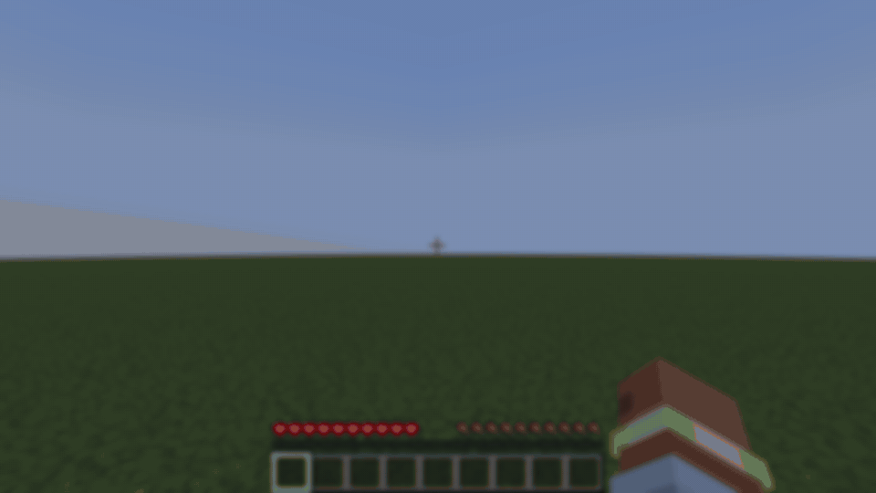
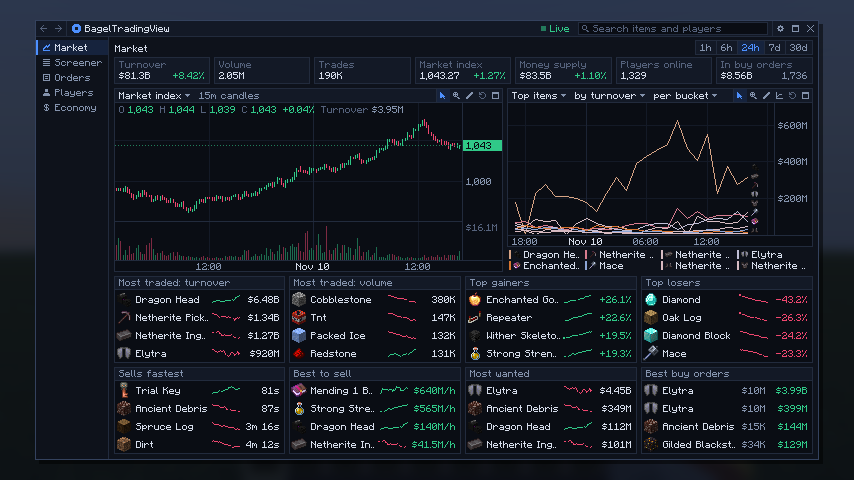
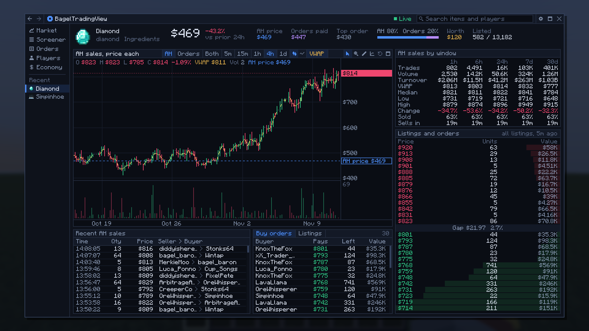
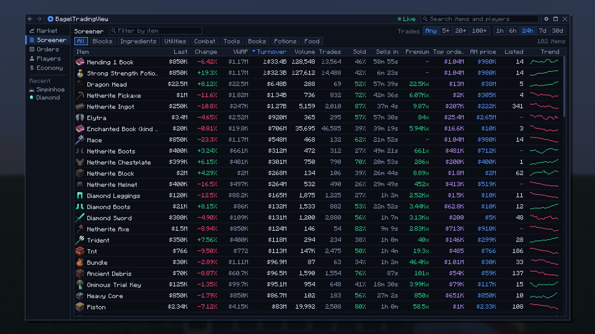
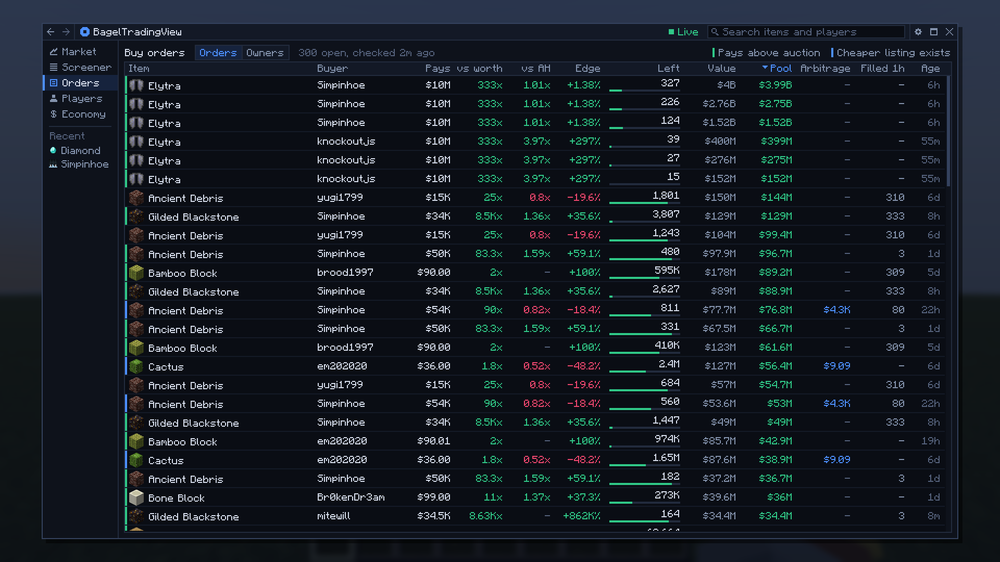
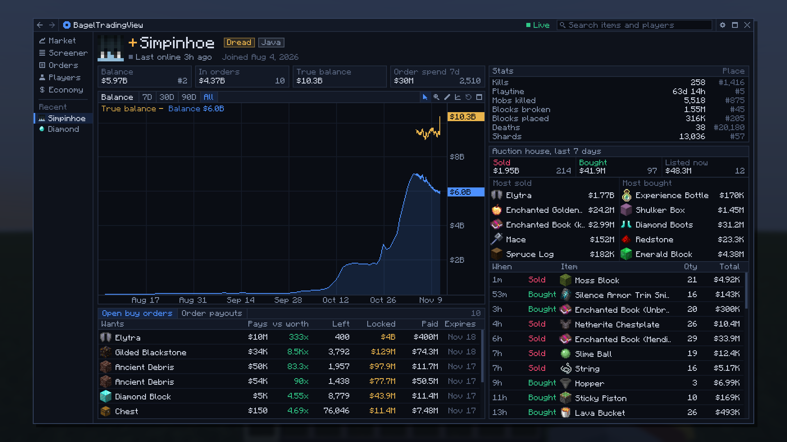
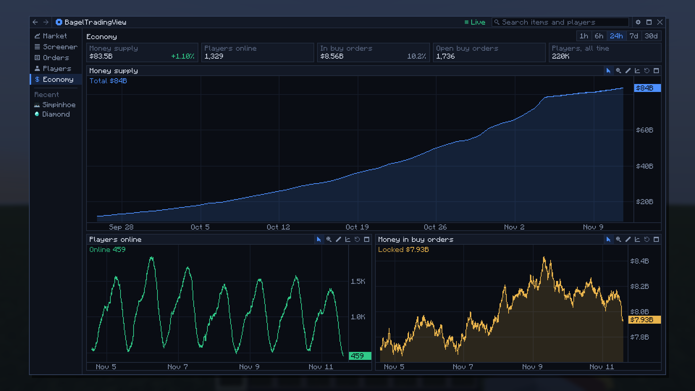

# BagelTradingView

A TradingView-style market terminal for the BagelSMP economy, inside Minecraft. Press **B** in game and it opens
over whatever you are doing: charts for every item, the auction house and buy orders side by side, and what every
player is really worth.



It is mostly a good-looking toy, but the numbers are real: you can watch auction house sales as they happen, see
which buy orders are worth filling, and look up a player's balance with the money they have locked in orders.

It is client-only and just reads a public API that has recorded BagelSMP's auction house, buy orders and
balances since November 10, 2026.

## Download

Get the jar for your Minecraft version from the
[latest release](https://github.com/Merkie/bagel-tradingview-mod/releases/latest):

| Minecraft | File ends in | Java |
| --- | --- | --- |
| 26.3 | `+26.3.jar` | 25 |
| 26.2 | `+26.2.jar` | 25 |
| 26.1.2 | `+26.1.2.jar` | 25 |
| 1.21.11 | `+1.21.11.jar` | 21 |

Put it in your `mods` folder. It needs [Fabric Loader](https://fabricmc.net/use/installer/) and nothing else: no
Fabric API, no other mods.

To change the key, click the gear in the terminal's title bar. If B is already taken and you cannot open the
terminal at all, install [Mod Menu](https://modrinth.com/mod/modmenu) and change it from the mod's settings
there, or edit `hotkey` in `config/bagel-tradingview.json`.

## What is in it

| | |
| --- | --- |
|  |  |
|  |  |
|  |  |

The screenshots come from the mod's tests, which run against a made-up market.

- **Market**: headline numbers, two chart slots that each show any board (market index, top items, top players'
  balances, money supply, players online, money in buy orders), and eight ranked lists.
- **Screener**: every traded item in a sortable table, with text, category and minimum-trades filters.
- **Item**: the price chart for either market (auction house sales, filled buy orders, or both as two lines) with
  volume and VWAP, sales by window, listings and orders by price, recent sales, open buy orders and current
  listings. The panels resize.
- **Orders**: every open buy order with the ones worth filling marked, and **Owners**: who ranks by what their
  orders actually paid out against what they only have locked up.
- **Players**: the rich list, and one player's balance over time, their orders, what those paid out, and their
  auction activity.
- **Economy**: money supply, players online, money in buy orders.

Every chart works the same way: wheel to zoom, drag to pan, Shift-drag or right-drag to zoom to a box, drag the
price axis to stretch it, double click to fit, log scale, maximize, and drawing tools behind the pencil. Drawings
are saved per chart.

It shows only what the data supports: an item with too few trades draws each sale as a dot, a window longer than
the recorded history says how much it really covers, and counts that are only a minimum carry a mark.

## Build it yourself

Each supported Minecraft version has its own branch: `mc-26.3`, `mc-26.2`, `mc-26.1.2` and `mc-1.21.11`. Use
JDK 25, or JDK 21 on `mc-1.21.11`.

```sh
./gradlew build              # build/libs/bagel-tradingview-<version>.jar
./gradlew runClientGameTest  # a hidden, muted client; screenshots in build/run/clientGameTest/screenshots/
```

A passing test run logs nine `PASS:` lines. The tests never reach the live API: the test mod starts `FakeApi`, a
local stand-in, and points the mod at it. They load Mod Menu to check the settings button.

```
src/client/java/com/merkie/bageltv/
  BagelTV.java, Config.java, Fmt.java   entry point and hotkey, settings file, money and time formatting
  ModMenuEntry.java                     the settings button in Mod Menu
  mixin/KeyboardHandlerMixin.java       the hotkey (no key mapping is registered)
  data/Api.java, Models.java            HTTP, per-path cache and refresh; the API's JSON shapes
  chart/                                the chart engine: Chart, Canvas, Series (Candles, Line, Histogram, Stack),
                                        TimeTicks, ValueFormat, Drawings, Spark
  ui/                                   TerminalScreen (window, rail, search, history), Ui (drawing and input for
                                        one frame, popovers, dropdowns), Theme, Icon, Table, TextField, Splitter,
                                        Items (icons and item colors), Heads (player faces), Intro (the startup
                                        animation), Hotkey and HotkeyScreen (the key, and Mod Menu's screen for it)
  view/                                 one class per view, plus Board (a chart with its own data), Parts (shared
                                        pieces) and Pager (paged lists)
src/gametest/                           FakeApi, Harness, the tests, fixtures captured from the live API
tools/                                  refresh the fixtures and the README's images
```
